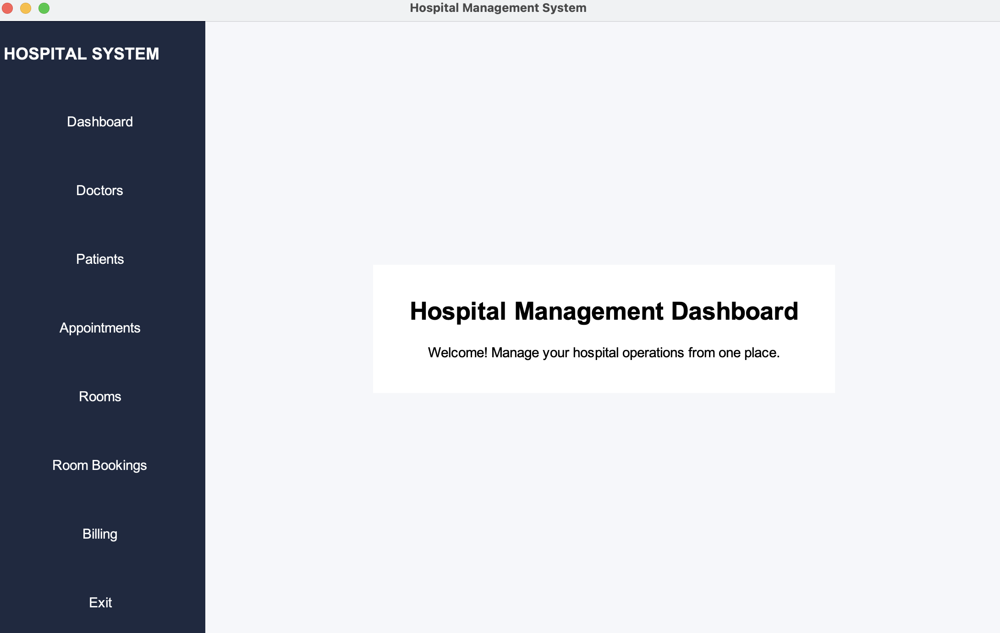
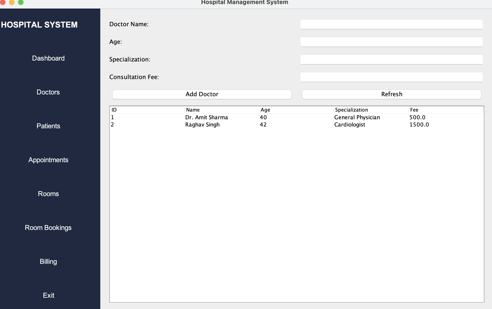
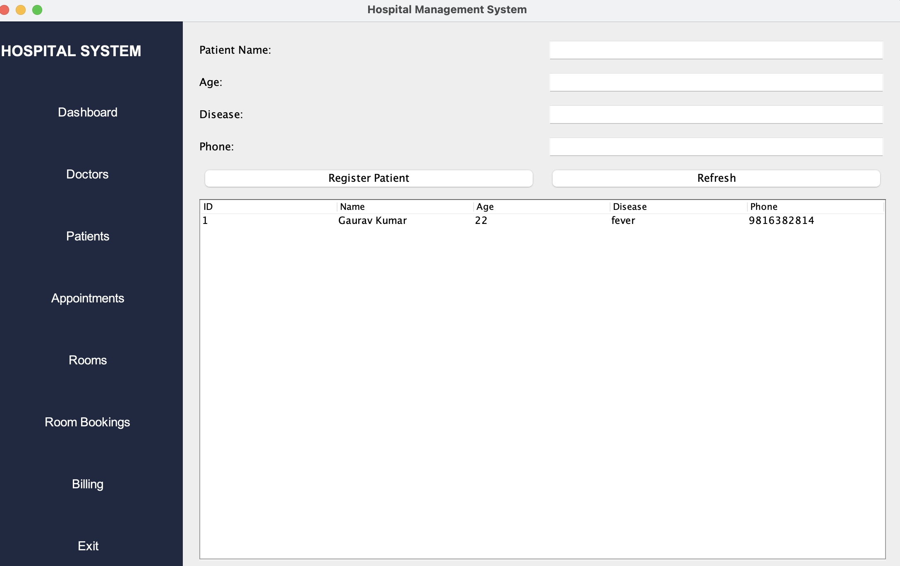
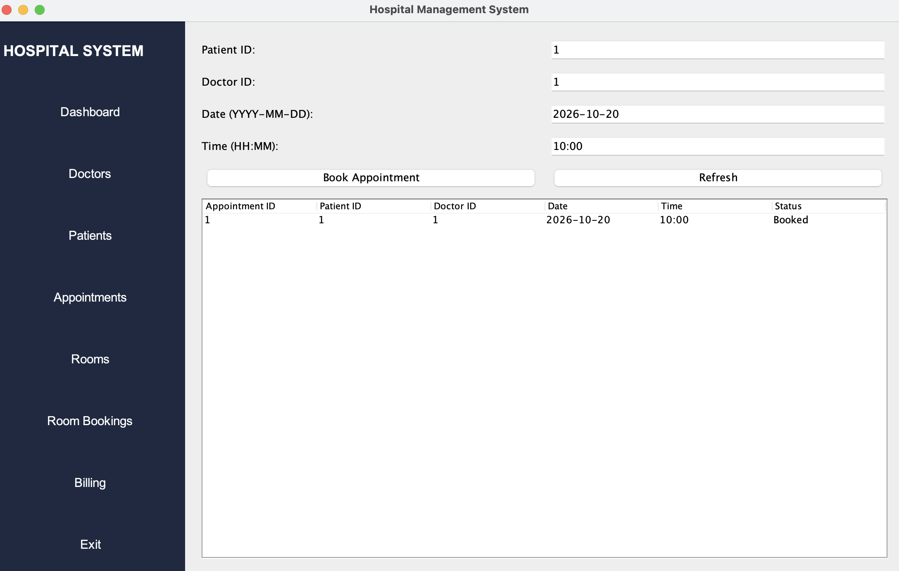
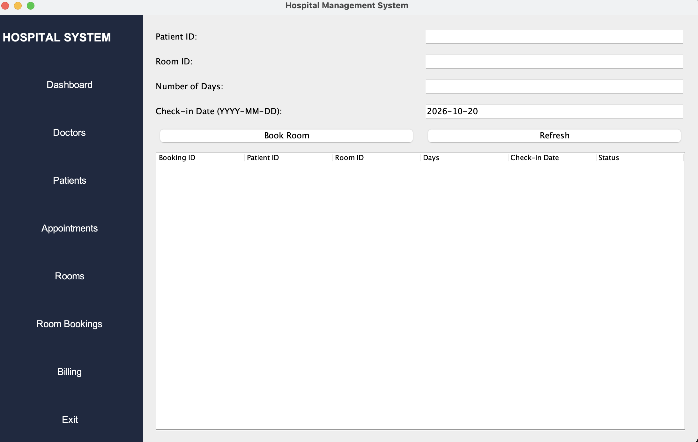
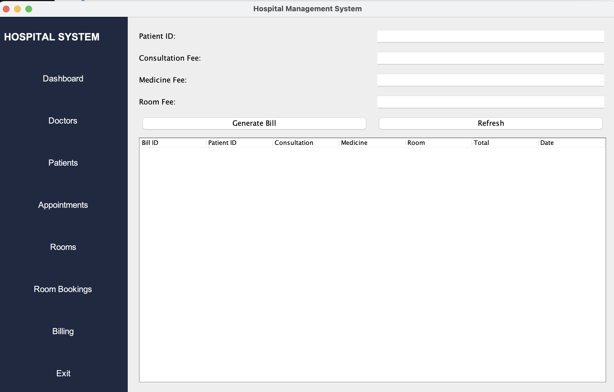

# Hospital Management System

A Java-based Hospital Management System developed using Java Swing, JDBC, and MySQL. The application provides a graphical interface for managing hospital operations.

## Features

- **Dashboard:** Navigation between hospital management modules.
- **Doctor Management:** Add and view doctor records.
- **Patient Management:** Register and view patients.
- **Appointment Management:** Manage patient appointments.
- **Room Management:** View and manage hospital rooms.
- **Room Booking:** Record patient room bookings.
- **Billing Management:** Generate and view patient bills.

## Technologies Used

- Java
- Java Swing (GUI)
- MySQL
- JDBC
- MySQL Connector/J
- Object-Oriented Programming

## Project Structure

```text
HospitalManagementSystem/
├── src/
│   ├── dao/
│   ├── database/
│   ├── exception/
│   ├── gui/
│   ├── interfaces/
│   ├── model/
│   ├── service/
│   └── Main.java
├── lib/
│   └── MySQL Connector/J
├── database/
└── README.md
```

## Database Setup

1. Install and start MySQL Server.
2. Create a database named `hospital_db`.
3. Execute the SQL script containing the required table definitions.
4. Configure the database connection in `DBConnection.java`.
5. Add MySQL Connector/J to the Java classpath.

## Academic Project

This project demonstrates Java GUI development, object-oriented programming, database connectivity using JDBC, and data access through DAO classes.

## Screenshots

### Dashboard


### Doctors


### Patients


### Appointments


### Rooms


### Room Bookings


### Billing

## Setup and Run

### Prerequisites
- Java JDK 17 or later
- MySQL Server
- MySQL Connector/J included in the `lib` folder

### 1. Configure the Database
Create the `hospital_db` database and required tables in MySQL.

### 2. Set the Database Password

**macOS (Terminal):**
```bash
export HOSPITAL_DB_PASSWORD='your_mysql_password'
```

**Windows PowerShell:**
```powershell
$env:HOSPITAL_DB_PASSWORD = "your_mysql_password"
```

### 3. Compile and Run

**macOS:**
```bash
mkdir -p out
javac -cp "lib/mysql-connector-j-26.7.0.jar" -d out $(find src -type f -name "*.java")
java -cp "out:lib/mysql-connector-j-26.7.0.jar" gui.DashboardFrame
```

**Windows PowerShell:**
```powershell
New-Item -ItemType Directory -Force out | Out-Null
$sources = Get-ChildItem src -Recurse -Filter *.java | ForEach-Object { $_.FullName }
javac -cp "lib/mysql-connector-j-26.7.0.jar" -d out $sources
java -cp "out;lib/mysql-connector-j-26.7.0.jar" gui.DashboardFrame
```

**Note:** Replace `your_mysql_password` with your actual MySQL password.